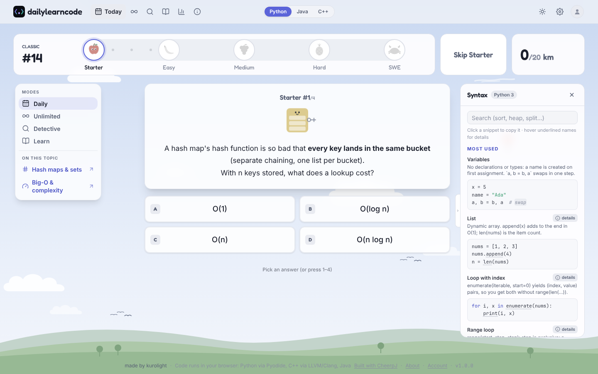
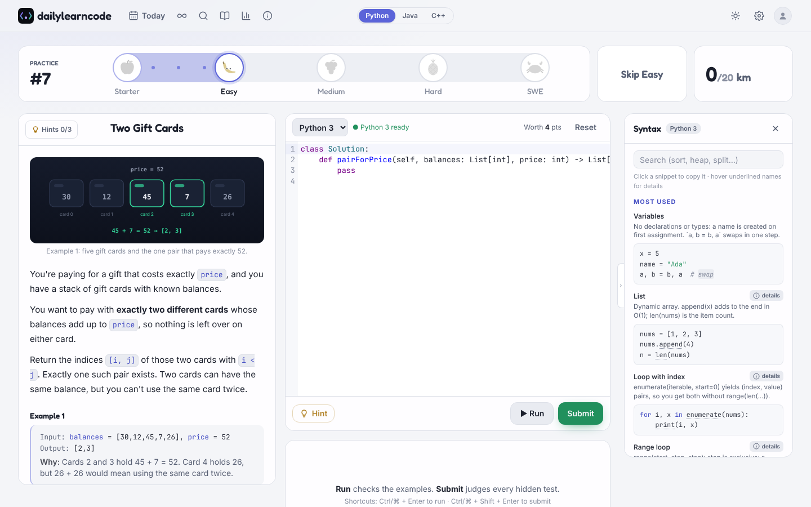
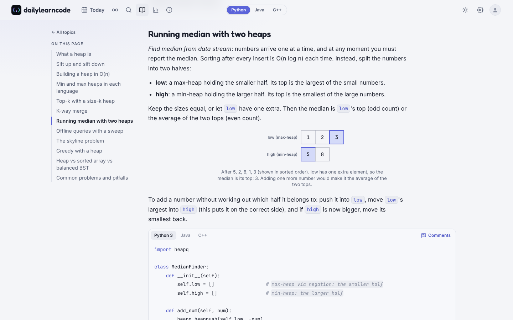
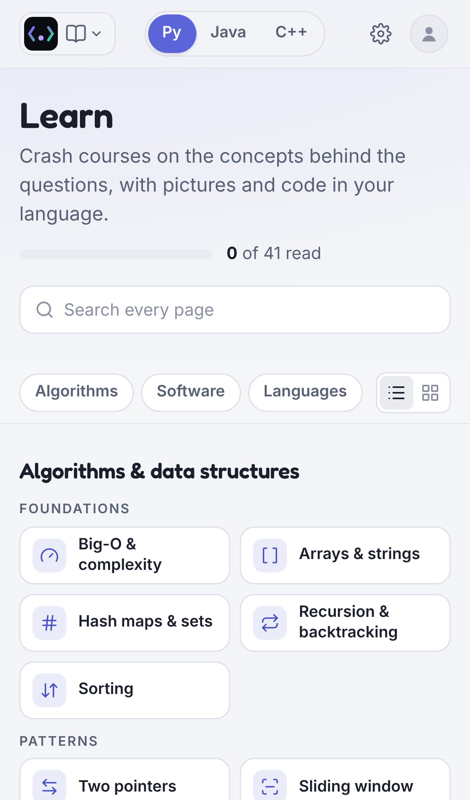

# dailylearncode

A daily coding-interview practice game that runs entirely in the browser. Each day has five short stages, scored out of
**20**:

| # | Stage | Points |
|---|---|---|
| 1 | Starter: algorithms quiz (4 questions) | 4 × 1 |
| 2 | Easy coding problem | 4 |
| 3 | Medium coding problem | 4 |
| 4 | Hard coding problem | 4 |
| 5 | Software-engineering quiz (4 questions) | 4 × 1 |

Solve the coding problems in **Python 3, Java or C++**. Your code compiles and runs **in your own browser**: no
server, no account, nothing to install.

| Daily quiz | Coding | Learn |
|---|---|---|
|  |  |  |

## Features

- **Daily set:** stages unlock in order. A coding task scores `4 − hints used` once every hidden test passes. Each
  task has three hints, an editorial and, often, alternative approaches. **Run** (examples only) is free and
  unlimited; **Submit** judges every hidden test.
- **Unlimited:** keep drawing quiz questions and problems from every set, or play rounds of software-engineering
  interview questions on the topics you pick.
- **Detective:** five short snippets per round, each with one flaw. Pick what's wrong, point at the bad line, or
  write the missing one. Missing lines are checked by running tests. Separate case files cover software design
  (classes, SOLID, patterns) and system design docs.
- **Learn:** crash-course pages for every topic the questions cover, with diagrams and code in your language. Also
  language crash courses for Python, Java, C++, JavaScript/TypeScript/React and SQL, written for people who already
  program in another language. Includes full-text search, find-on-page and a contents sheet on phones.
- **Stats:** scores, a 🔥 streak, per-topic accuracy, an archive of past sets and the mistakes worth reviewing.
- **Quality of life:**
  - A syntax cheat sheet beside the editor
  - Language-aware quiz questions
  - Light and dark themes
  - A shortcut-key bar above the phone keyboard
  - A shareable, spoiler-free emoji summary
  - Export and import of your progress, plus optional sync to the player's own Google Drive

<p align="center"></p>

## Run it locally

You need Node 22 (see `.node-version`).

```bash
npm install
```

```bash
npm run dev
```

Open http://localhost:5173. The repository ships with **a week of sample sets** (2026-11-06 to 2026-11-12), so
"Today" replays one of them as a *classic* until there is a set for the current date. Past sets are playable from
the archive on the Stats page.

Other useful commands:

```bash
npm run lint && npm run typecheck && npm test
```

```bash
npm run content:validate
```

`content:validate` compiles and runs every reference solution with real `python3`, `javac` (JDK 21) and `g++` (C++23),
and checks every Learn page. It needs those toolchains on your PATH.

```bash
npm run build && npm run serve:dist
```

That builds the site and serves `dist/` the way the production host does (it applies `public/_headers`). With that
server running, `npm run e2e` plays a full day in all three languages with Playwright.

## How it works

```
React + Vite single-page app, served as static files
  /days/<date>.json         daily sets (built from content/days/)
  /bank, /detective, /learn question banks, Detective cases, Learn pages

In the browser
  Python 3  → Pyodide (CPython on WebAssembly) in a Web Worker
  C++23     → Clang/LLD on WebAssembly (YoWASP) in a Web Worker → wasm32-wasi → WASI shim
  Java 21   → CheerpJ (a JVM on WebAssembly) in a hidden same-origin iframe
```

- **No execution server.** Each runtime runs in an isolated worker or frame. It is killed and recreated when it
  exceeds its time limit. Toolchains download on first use and are cached by the browser.
- **One harness for every language.** A problem declares a typed signature, e.g.
  `fn(nums: int[], k: int) -> list<list<int>>`. `src/runner/harness/` generates the starter code and a driver program
  for each language. The same code drives the browser and `content:validate`, so CI exercises it on every problem.
- **Expected outputs are computed, not written by hand.** `content:finalize` runs the Python reference solution on
  every test input. `content:validate` then requires the Java and C++ references to agree on every test.
- **Progress lives in `localStorage`.** The About page has export, import and reset.
- **Spoiler window.** Production builds publish days only up to UTC today + 1, so you can commit sets ahead of
  time.

### Project layout

```
content/days/         daily sets (expected outputs already computed)
content/drafts/       optional: hand-written drafts before finalize (see docs/content-format.md)
content/bank/         extra quiz questions for Unlimited (swe) and its SWE interview mode (interview)
content/detective/    Detective cases: leet (algorithms), swe, oop (software design), design (system design)
content/learn/        Learn pages, one Markdown file per page (format: docs/learn-pages.md)
content/patch-notes.md   release notes shown at /patch-notes
src/site.ts           name, credit and per-deployment settings
src/content/topics.ts the topic map: every tag belongs to a topic, every topic has a Learn page
src/runner/           harness (signature DSL, starters, drivers, judging), workers, Java frame
src/game/             scoring, store (zustand), streaks, share text, sounds and confetti
src/syntax/           per-language cheat sheets for the syntax panel
scripts/              build-content, finalize, validate-content, validate-learn, solution-comments
public/_headers       security headers and CSP
tests/e2e/            static server that applies _headers, plus a Playwright smoke test
```

## Deploying your own copy

This repository is the website only. To run a public copy you set up the hosting, domain, optional sign-in and
your own legal pages. Notes for each part follow.

### Hosting

The build is a static site: `npm run build` writes `dist/`. Any static host works if it:

1. falls back to `index.html` for unknown paths (client-side routing), and
2. applies the headers in `public/_headers`, or your host's equivalent. The CSP there allows exactly the CDNs the
   runtimes load from (jsDelivr for Pyodide and Clang, `cjrtnc.leaningtech.com` for CheerpJ). The Java frame needs its
   own, looser policy.

`wrangler.jsonc` is set up for a **Cloudflare Worker with static assets**, which does both:

- Connect the repository in *Workers & Pages → Create → Import a repository*.
- Build command: `npm run build`. Deploy command: `npx wrangler deploy`.
- Add a custom domain under *Settings → Domains & Routes*.

Or deploy from your machine with `npm run deploy`. Cloudflare's builds for branches other than `main` count as
previews and publish every day, including future ones; set `PRODUCTION_BRANCHES` to change which branches are
production.

### Build variables

All are optional. Set them as build variables on your host, or in `.env.local` for development (see `.env.example`).

| Variable | What it does |
|---|---|
| `VITE_SITE_URL` | Your site's address, e.g. `https://code.example.com`. Added to the share text. Only this host counts as production; any other host shows a preview badge. |
| `VITE_PRIVACY_URL`, `VITE_TERMS_URL` | Links to **your** privacy policy and terms. The footer and About page show them only when set. |
| `VITE_GOOGLE_CLIENT_ID` | Turns on optional Google Drive sync (below). |
| `VITE_GOOGLE_REDIRECT` | `1`: phones sign in to Google in the same tab instead of a popup. Needs `<origin>/oauth` as an authorised redirect URI. |

### Privacy policy and terms

The app itself has no accounts, cookies or analytics, and keeps progress in the browser. Your deployment can still
collect data: your host's logs, any analytics you add, and the CDNs that serve the language runtimes all see
visitors' IP addresses. Drive sync adds Google sign-in. **Write a privacy policy and terms that match your setup**,
host them anywhere and link them with the variables above. Google requires both before it will publish an OAuth app.

If you add analytics, update the sentence about it on the About page (`src/pages/AboutPage.tsx`) and allow its
script in the CSP.

### Optional: Google Drive sync

Players can save their progress (and, if they choose, their code) as files in **their own** Google Drive. There is no
server: the browser gets a short-lived token from Google and calls the Drive API directly, with the `drive.file`
scope, so the site can only see files it created.

1. In the [Google Cloud console](https://console.cloud.google.com), create a project and enable the **Google Drive
   API**.
2. Under *Google Auth Platform*, configure the consent screen:
   - Your app name and support email
   - Your domain, home page, privacy policy and terms URLs
   - Under *Data access*, add the scope `.../auth/drive.file`
3. Create an OAuth client (*Web application*):
   - **Authorised JavaScript origins:** your site's origin and `http://localhost:5173`.
   - **Redirect URIs** (only for `VITE_GOOGLE_REDIRECT=1`): `<origin>/oauth`.
4. Publish the app under *Audience*. While it is in "Testing", only listed test users can sign in. With only
   `drive.file`, publishing needs no Google review, though Google may ask you to verify your domain before it shows
   your name and logo.
5. Set `VITE_GOOGLE_CLIENT_ID` to the client ID and rebuild. The ID is public by design, so it is not a secret.

Sync merges before it uploads, so two devices never overwrite each other's progress. Browser tokens last about an
hour, so after that auto-sync waits until the player clicks the sync button.

### Content and spoilers

Quiz answers and hidden tests ship to the browser as JSON, and everything in a public repository is readable.
That's fine for self-practice, but **don't build leaderboards on client-reported scores**: they would need
server-side judging. If you plan daily sets ahead of time, keep them somewhere private until their day, or accept
that they're visible on GitHub.

## Adding content

[docs/content-format.md](docs/content-format.md) covers the file formats, tags and how to add a day, quiz questions or
Detective cases. [docs/learn-pages.md](docs/learn-pages.md) covers Learn pages. The short version: write the content,
then run `npm run content:validate`, which must pass.

## Known limitations

- **First use of a language downloads its toolchain:** Python about 10 MB, C++ about 30 MB, Java from the CheerpJ
  CDN. Later runs use the browser cache.
- **Java is the slowest.** The first submit takes around 30 s (JVM start and `javac`); later ones take 6–10 s.
  CheerpJ runs on the page thread, so the tab can pause briefly while Java runs.
- **C++ has no exceptions** (`throw`/`try`) in the WebAssembly sysroot, and `size_t` and pointers are 32-bit.
- Timing depends on the device, so limits are generous, and large hidden tests are sized so a worse complexity
  class still fails. Coding works best on a desktop.

## Contributing

Pull requests are welcome: bug fixes, new problems, quiz questions, Detective cases and Learn pages. See
[CONTRIBUTING.md](CONTRIBUTING.md). Report security issues privately as described in
[docs/SECURITY.md](docs/SECURITY.md).

## Licence

[MIT](LICENSE), made by [kurolight](https://kurolight.dev). The licence covers the code and the content in this
repository. Third-party software and fonts keep their own licences; see
[THIRD_PARTY_NOTICES.md](THIRD_PARTY_NOTICES.md). **Java runs on CheerpJ,** which is free under its Community
licence for personal and non-commercial use. Check Leaning Technologies' terms before a commercial or
organisational deployment, and keep the "Built with CheerpJ" credit.

Problems are original exercises; some link to a similar LeetCode problem for reference. LeetCode is a trademark of
its owner, and this project is not affiliated with it.
